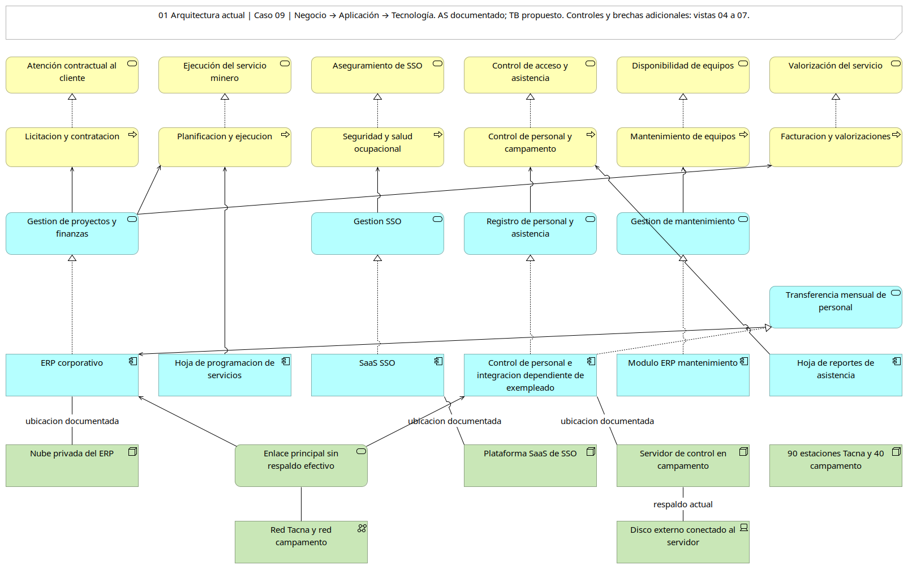
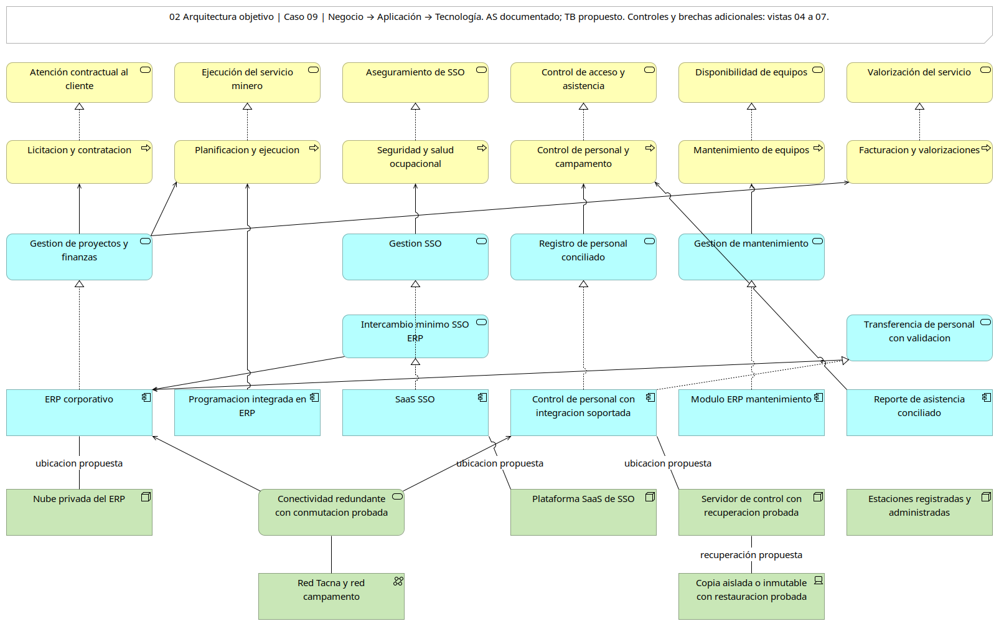
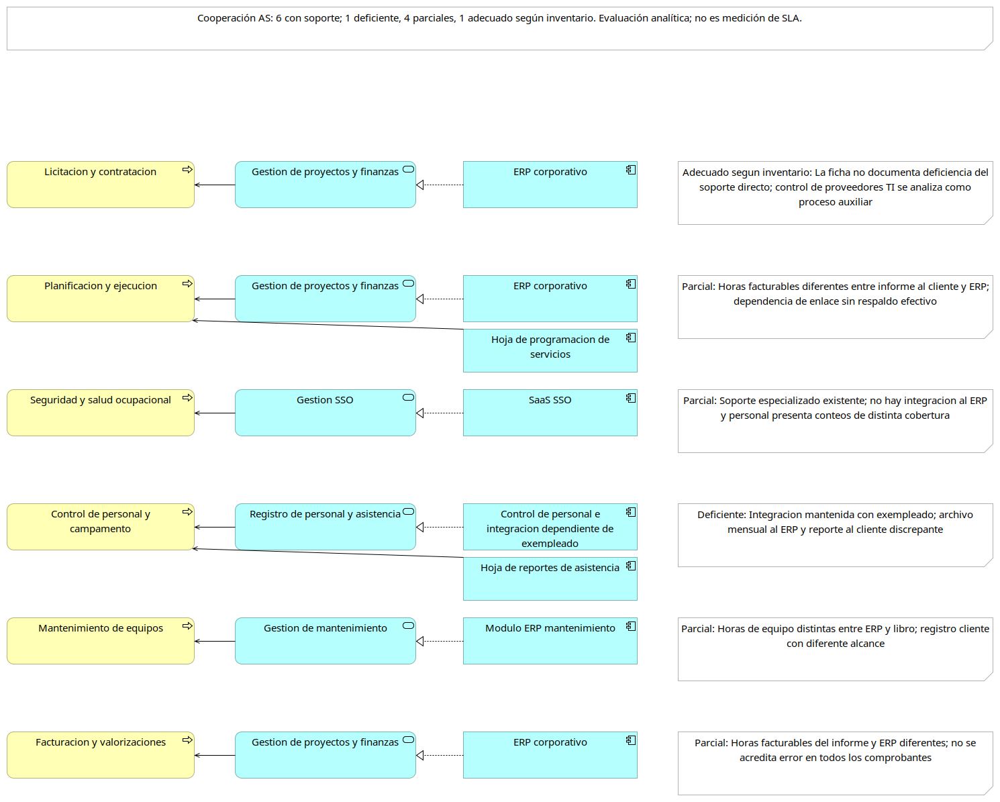

# Informe S10 · Grupo 1 · Caso 09

**Versión pública sin códigos estudiantiles.** La carátula completa y el PDF se entregan por Drive/aula virtual.

UNIVERSIDAD PRIVADA DE TACNA

FACULTAD DE INGENIERÍA

ESCUELA DE INGENIERÍA DE SISTEMAS

TALLER

“Modelado de la arquitectura actual y objetivo en Archi”

CURSO:

“ Planeamiento Estratégico de TI”

AUTOR(ES):

Carbajal Vargas, Andre Alejandro

Yupa Gómez, Fátima Sofía

Llanos Niño, Vincenzo Rafael

DOCENTE:

DR. OSCAR JUAN JIMENEZ FLORES

TACNA — PERÚ

2026

Índice

## 1. Información sobre el evento práctico

### 1.1 Título del evento práctico

Modelado de la arquitectura actual y objetivo de Servicios Mineros Cordillera S.A.C. y análisis de brechas para su PETI.

El análisis prioriza la continuidad del enlace del campamento, el control de contratos y la evidencia de homologación. Estos aspectos responden al objetivo de TI declarado en la ficha del caso. La interrupción de 14 horas demuestra que disponer nominalmente de un respaldo no garantiza que esté operativo cuando el negocio lo necesita.

### 1.2 Objetivos

Establecer principios que orienten las decisiones de continuidad, datos, integración y control de servicios del caso 09.

Representar los procesos, aplicaciones, datos y tecnología existentes con trazabilidad a la ficha y al inventario.

Evaluar el soporte de los seis procesos e identificar diferencias entre sistemas y reportes.

Proponer cambios de arquitectura vinculados con la homologación y la continuidad, explicitando las validaciones necesarias.

Derivar brechas, paquetes de trabajo y dependencias mediante un programa reproducible.

### 1.3 Tiempo de duración

Una sesión de laboratorio y trabajo de consolidación del equipo. La guía consultada no establece una cantidad de minutos; la duración efectiva se registra al cerrar la sesión, sin presentar una estimación como tiempo ejecutado.

### 1.4 Resultados de aprendizaje

Al finalizar, el equipo debe poder distinguir componentes de aplicación de infraestructura, justificar una arquitectura objetivo a partir de hechos del negocio y demostrar cómo una dependencia condiciona la secuencia de implementación. También debe reconocer los límites de los conteos y la diferencia entre una comprobación estructural y una validación del modelo en Archi.

### 1.5 Recursos

| Recurso | Versión o referencia | Uso y estado |
| --- | --- | --- |
| Ficha del caso 09 | Material del curso; datos de 2025 | Hechos de gobierno, procesos, incidente y datos entregados |
| Inventario de arquitectura actual | 25 de junio de 2026 | Sistemas, integraciones, entidades, nodos y redes |
| Archi y ArchiMate | Archi 5.10.0 / ArchiMate 3.2 | Carga, guardado, recarga y siete PNG exportadas por motor nativo |
| Python | Python 3.12.14 | Generación de CSV, agrupación y orden topológico |
| pandas | pandas 2.2.3 | Matrices de brechas y paquetes |
| CSV | UTF-8 | Tablas versionables de entidades y soporte de procesos |
| Git y GitHub | Repositorio público del Grupo 1 | PR, ramas develop/main y etiquetas de entrega; requisito privado pendiente |
| Plantilla grupal | SI886-S10-TALLER-Grupo_N1.docx | Estructura de siete secciones y datos de carátula |

Las siete PNG se exportaron con el motor nativo de Archi 5.10.0 mediante su generador HTML. No son capturas de una sesión gráfica ni previsualizaciones de Pillow. Se incorporan tres vistas principales numeradas y se enlazan los archivos a tamaño original.

### 1.6 Seguridad

La guía clasifica el modelo completo como restringido y solicita un repositorio privado. Este repositorio público contiene una representación agregada del caso académico; su publicación no acredita el requisito de repositorio privado de la guía. Las vistas omiten direcciones IP, credenciales, rutas internas y versiones vulnerables. La matriz utiliza conteos agregados, sin nombres de trabajadores, documentos de identidad ni registros biométricos. Los conteos publicados por el caso se usan como insumo académico; no se afirma haber auditado los archivos de transacciones.

## 2. Procedimiento o metodología

### Paso A Declarar los principios de arquitectura

Se contrastaron la ficha y el inventario para identificar reglas que eviten repetir los problemas descritos. Se redactaron siete principios en 05_arquitectura/AR01_principios.md; cada uno incluye nombre, declaración, razón, implicancias y trazabilidad.

| Código | Principio | Decisión que orienta |
| --- | --- | --- |
| PA01 | Continuidad demostrable | Contratar, mantener y probar la alternativa de conectividad y la recuperación |
| PA02 | Dato único con responsabilidad | Formalizar fuentes, dueños y conciliaciones antes de integrar |
| PA03 | Integraciones mantenibles | Documentar, asignar soporte y probar la reversión |
| PA04 | Identidad individual | Atribuir acciones y reducir privilegios compartidos |
| PA05 | Evidencia desde el diseño | Registrar controles, obligaciones, cambios y aceptación |
| PA06 | Protección según clasificación | Limitar acceso y circulación de información personal |
| PA07 | Reutilización con soporte | Evaluar capacidades del ERP y SaaS antes de duplicarlas |

La relación entre PA01 y el incidente es directa: el satélite existía como alternativa, pero su contrato había vencido nueve meses antes. La recuperación requiere tanto condiciones técnicas como gestión contractual.

### Paso B Representar la arquitectura actual

El catálogo AR05_catalogo.csv y el modelo AR05_Cordillera.archimate contienen los estados AS/TB y siete vistas. Se añadieron servicios y objetos de negocio, servicios de aplicación visibles, controles de gobierno e información conectada. El enlace permanece en tecnología; las tres hojas operativas se representan como aplicaciones.

Negocio. Se representan licitación y contratación, planificación y ejecución, seguridad y salud ocupacional, control de personal y campamento, mantenimiento y facturación. Se incorporan procesos auxiliares de contratos, administración de TI, soporte, cambios y homologación, sustentados en los hechos de la ficha.

Aplicación. El ERP corporativo corre en nube privada y dispone de soporte con SLA. SSO es SaaS; control de personal se apoya en biometría y en un sistema de proveedor. Mantenimiento es un módulo del ERP. Se incluyen las hojas de programación de servicios, vencimientos contractuales y reportes de asistencia, porque sostienen tareas operativas y no pueden omitirse del modelo.

Tecnología. Se representan la nube privada del ERP, el SaaS, el servidor del campamento, las estaciones de Tacna y campamento, la conectividad entre sedes, el respaldo satelital inoperativo y el disco externo conectado al servidor. La ubicación se representa sin detalles internos sensibles.

Cooperación proceso aplicación. La evaluación de soporte se registra en [AR04_proceso_aplicacion.csv](https://github.com/Sofxx7/SI886-PETI-SEMANA10-Ficha9/blob/taller-10/05_arquitectura/AR04_proceso_aplicacion.csv).

| Proceso | Soporte actual | Evaluación y evidencia |
| --- | --- | --- |
| Licitación y contratación | ERP | Adecuado según inventario; no se acredita una deficiencia directa de este proceso |
| Planificación y ejecución | ERP y hoja de programación | Parcial: horas facturables distintas entre informe y ERP |
| Seguridad y salud ocupacional | SaaS SSO | Parcial: sin integración al ERP; revisar cobertura de personal |
| Control de personal y campamento | Biométrico, sistema proveedor y hoja de reporte | Deficiente: dependencia del exempleado, archivo mensual y reporte discrepante |
| Mantenimiento | Módulo ERP y libro de operaciones | Parcial: horas distintas entre ambas fuentes |
| Facturación y valorizaciones | ERP | Parcial: requiere validar las horas que originan las valorizaciones |

Los seis procesos tienen algún soporte. Cinco de seis presentan soporte parcial o deficiente y uno de seis, control de personal, se clasifica como deficiente. No se identifican procesos totalmente sin sistema en la lista del caso. La clasificación es un juicio del análisis, no una medición de disponibilidad ni una afirmación de que todas las facturas están erradas.

Estructura de la información. Se registraron seis entidades en [AR02_entidades.csv](https://github.com/Sofxx7/SI886-PETI-SEMANA10-Ficha9/blob/taller-10/05_arquitectura/AR02_entidades.csv). Las cuatro primeras proceden del inventario; Proveedor y Pago se incorporan desde los conjuntos de datos descritos en la ficha.

| Entidad | Ubicaciones y conteos acreditados | Fuente y dueño actuales | Observación |
| --- | --- | --- | --- |
| Personal | ERP 420; biométrico hasta 700; SSO 480; planilla 420 | Sin fuente; Operaciones de hecho | Picos y plantillas no son poblaciones equivalentes |
| Equipo | ERP 310; libro 310; cliente 290 | ERP; Superintendente de Mantenimiento | Diferencia de conteos 20 y horas por conciliar |
| Contrato | ERP 140; hoja 140; papel 140 | Sin fuente ni dueño | Conteos iguales no garantizan vigencia |
| Servicio | ERP, libro e informe; 36 al año, sin desglose por sistema | ERP; Gerente de Operaciones | Horas facturables diferentes |
| Proveedor | proveedores.csv: 210 en 2025 | Sistema de origen, fuente y dueño no documentados | Contiene contacto y documento de identidad |
| Pago | pagos.csv: 25 185 en 2025 | Sistema de origen, fuente y dueño no documentados | Transacciones con registrador y aprobador |

Fuentes: 2/6 declaradas (Equipo y Servicio), 2/6 expresamente ausentes (Personal y Contrato) y 2/6 no documentadas (Proveedor y Pago). Dueños: 2/6 cargos explícitos, 1/6 responsable de hecho (Personal), 1/6 expresamente ausente (Contrato) y 2/6 no documentados. No se confunde información desconocida con ausencia comprobada.

Se marcan tres entidades con datos personales: Personal, Proveedor y Pago. Personal se clasifica como restringida según el inventario; la clasificación confidencial de Proveedor y Pago es una propuesta pendiente de aprobación. La ficha registra 421 personas en A y 420 registros de empleados en I: se requiere conciliar fecha y alcance, sin corregir arbitrariamente uno de los valores.

Figura 1. Arquitectura actual — exportación nativa de Archi 5.10.0.

### Paso C Construir la arquitectura objetivo

Se tomó como base acreditada el objetivo de TI de la ficha: cerrar observaciones de homologación y asegurar la continuidad del enlace. Se formularon capacidades propuestas en [AR06_derivacion_objetivo.md](https://github.com/Sofxx7/SI886-PETI-SEMANA10-Ficha9/blob/taller-10/05_arquitectura/AR06_derivacion_objetivo.md) para contratos y evidencia, conectividad, conciliación, mantenimiento de integraciones, identidad y gestión de servicios.

La arquitectura objetivo conserva las capacidades soportadas del ERP y del SaaS y propone integraciones documentadas, maestros con responsabilidad, programación conciliada, control contractual con alertas, conectividad redundante, copias aisladas o inmutables y registros de gestión. La ampliación de módulos depende de validar licencias, funciones, soporte y costo total con proveedores.

Se elaboró una base estratégica específica de Cordillera con visión y métricas (2.2), diagnóstico (3.1.3), capacidades (3.1.5), FODA cruzado (3.5), proyectos no negociables (4.1.5) y marcos (4.2). Es una propuesta académica de esta revisión, no un PETI previo aprobado. AR07_trazabilidad.csv enlaza cada brecha a esos insumos, principios, conceptos AS/TB y criterio de aceptación. El equipo y los responsables deben ratificarla antes de implantar.

Figura 2. Arquitectura objetivo propuesta — exportación nativa de Archi 5.10.0.

### Paso D Analizar brechas y derivar paquetes

Se adaptó el programa de la guía a los hechos de Servicios Mineros Cordillera. Se añadieron identificadores únicos, relaciones a ambos estados del modelo y comprobaciones de integridad. La secuencia se calcula mediante orden topológico, por lo que un ciclo o una dependencia desconocida genera un error en lugar de imprimir una secuencia fija.

Desde 05_arquitectura/ se ejecutó:

python AR03_brechas.py

python AR05_modelo.py

Se obtuvieron 17 brechas: seis de negocio, cinco de aplicación, tres de datos y tres de tecnología. El esfuerzo se estimó ordinalmente como bajo, medio o alto: tres brechas bajas, doce medias y dos altas. No son días, soles ni una cotización.

| Paquete | Brechas | Esfuerzo máximo | Dependencias |
| --- | --- | --- | --- |
| PT01 Gobierno contractual y evidencia | BR01, BR15, BR16 | Medio | Ninguna |
| PT02 Gobierno y conciliación del dato | BR06, BR07, BR17 | Medio | PT01 |
| PT03 Continuidad de enlace y respaldos | BR02, BR11 | Alto | PT01 |
| PT04 Integración y programación operativa | BR03, BR04, BR05, BR08 | Alto | PT02, PT03, PT05, PT06 |
| PT05 Identidad y control de acceso | BR09, BR10 | Medio | PT01 |
| PT06 Gestión de servicios, cambios y activos | BR12, BR13, BR14 | Medio | PT01 |

La secuencia propuesta es PT01 en el primer nivel; PT02, PT03, PT05 y PT06 en el segundo; PT04 en el tercero. La posición en el mismo nivel permite trabajo paralelo solo si existen personas y recursos. No se retrasa la recuperación del respaldo hasta completar la integración; PT03 debe resolver esa exposición antes de depender de intercambios más frecuentes.

| ID | Cambio principal | Capa | Paquete |
| --- | --- | --- | --- |
| BR01 | Alertas y responsabilidad contractual | Negocio | PT01 |
| BR02 | Redundancia efectiva y prueba de conmutación | Tecnología | PT03 |
| BR03 | Soporte y documentación de integración de personal | Aplicación | PT04 |
| BR04 | Transferencia de personal con validación y frecuencia aprobada | Aplicación | PT04 |
| BR05 | Intercambio mínimo SSO ERP | Aplicación | PT04 |
| BR06 | Fuente y dueño de Personal | Datos | PT02 |
| BR07 | Fuente y dueño de Contrato | Datos | PT02 |
| BR08 | Programación integrada y conciliada | Aplicación | PT04 |
| BR09 | Administración con identidad individual | Negocio | PT05 |
| BR10 | MFA en servicios críticos compatibles | Tecnología | PT05 |
| BR11 | Copias aisladas o inmutables y restauración | Tecnología | PT03 |
| BR12 | Registro y tratamiento de incidentes | Negocio | PT06 |
| BR13 | Evaluación y aprobación previa de cambios | Negocio | PT06 |
| BR14 | Inventario y registro de configuración | Aplicación | PT06 |
| BR15 | Registro y validación de cierre de homologación | Negocio | PT01 |
| BR16 | Revisión difusión y capacitación sobre política | Negocio | PT01 |
| BR17 | Conciliación de horas de equipos | Datos | PT02 |

### Paso E Preparar vistas y sección 5 del PETI

Se exportaron siete vistas desde Archi: arquitectura actual, objetivo, cooperación, información, gobierno actual, gobierno objetivo y comparación de brechas. La sección 5 se incorpora íntegramente en el Anexo F y permanece versionada en 05_arquitectura_empresarial.md.

Figura 3. Cooperación proceso–aplicación — exportación nativa de Archi 5.10.0.

Las PNG se copiaron sin redibujar desde images/ del reporte generado por Archi. Los archivos originales permiten ampliar la lectura. Los comandos y el registro de exportación están en AR08_validacion.md y evidencias/S10/salidas/Archi_exportacion.txt.

### Paso F Validar y corregir

Se comprobó el XML, la unicidad de IDs, referencias internas y la visibilidad de las 17 brechas en ambos estados. Se ejecutaron tres pruebas de dependencias: secuencia válida, ciclo y referencia desconocida. Archi cargó el modelo, exportó siete vistas y guardó una copia nativa que volvió a cargarse y exportarse a CSV.

Se revisó la correspondencia de las siete aplicaciones actuales con FICHA C e inventario 2/4. Las 113 relaciones se contrastaron con la matriz oficial incluida en Archi 5.10: cero tipos de relación inválidos. La revisión de capas, aplicaciones y brechas queda en AR08_validacion.md. La ejecución fue mediante el motor nativo y CLI; no se afirma una sesión interactiva humana en la GUI ni aprobación de la arquitectura por el negocio.

### Paso G Registrar evidencias y cerrar

El PR #1 ya estaba fusionado en develop. Las correcciones se integran mediante un PR hacia develop y sincronización de main. Las etiquetas v0.10 y taller-10 fijan la versión académica revisada; no certifican implantación, aceptación del negocio ni cumplimiento de la condición de privacidad.

Los resultados enlazan artefactos de la etiqueta taller-10, que identifica el commit entregado. Los registros de carga, exportación y pruebas se conservan separados de las propuestas. El PDF se entrega por el aula virtual; no se publican códigos estudiantiles en GitHub.

## 3. Resultados

La tabla distingue lo comprobado de las reservas. Un archivo o una etiqueta no acredita que los cambios se hayan implantado en la organización. Se preservan los límites de datos y privacidad.

| N.º | Resultado esperado | Estado comprobado | Evidencia verificable |
| --- | --- | --- | --- |
| 1 | Seis principios completos | Siete completos y trazados al diagnóstico académico | [AR01_principios.md](https://github.com/Sofxx7/SI886-PETI-SEMANA10-Ficha9/blob/taller-10/05_arquitectura/AR01_principios.md) |
| 2 | Modelo actual en tres capas | Modelo cargado y guardado en Archi; capas revisadas | [AR05_Cordillera.archimate](https://github.com/Sofxx7/SI886-PETI-SEMANA10-Ficha9/blob/taller-10/05_arquitectura/AR05_Cordillera.archimate) [AR08_validacion.md](https://github.com/Sofxx7/SI886-PETI-SEMANA10-Ficha9/blob/taller-10/05_arquitectura/AR08_validacion.md) |
| 3 | Hojas como aplicaciones | Tres hojas como componentes visibles | [AR05_catalogo.csv](https://github.com/Sofxx7/SI886-PETI-SEMANA10-Ficha9/blob/taller-10/05_arquitectura/AR05_catalogo.csv) |
| 4 | Cooperación proceso aplicación | Seis procesos, relaciones y evaluación en PNG de Archi | [AR04_proceso_aplicacion.csv](https://github.com/Sofxx7/SI886-PETI-SEMANA10-Ficha9/blob/taller-10/05_arquitectura/AR04_proceso_aplicacion.csv) [V03_cooperacion.png](https://github.com/Sofxx7/SI886-PETI-SEMANA10-Ficha9/blob/taller-10/graficos/V03_cooperacion.png) |
| 5 | Seis entidades y conteos | Seis entidades; límites de origen/conteos declarados | [AR02_entidades.csv](https://github.com/Sofxx7/SI886-PETI-SEMANA10-Ficha9/blob/taller-10/05_arquitectura/AR02_entidades.csv) |
| 6 | Fuentes y dueños ausentes contados | Fuentes y dueños clasificados y contados | [AR02_entidades.csv](https://github.com/Sofxx7/SI886-PETI-SEMANA10-Ficha9/blob/taller-10/05_arquitectura/AR02_entidades.csv) |
| 7 | Datos personales y clasificación | Tres con datos personales; dos clasificaciones propuestas | [AR02_entidades.csv](https://github.com/Sofxx7/SI886-PETI-SEMANA10-Ficha9/blob/taller-10/05_arquitectura/AR02_entidades.csv) |
| 8 | Objetivo trazado a su origen | 17 cambios trazados a base académica, principios y modelos; ratificación pendiente | [00_base_estrategica_caso09.md](https://github.com/Sofxx7/SI886-PETI-SEMANA10-Ficha9/blob/taller-10/05_arquitectura/00_base_estrategica_caso09.md) [AR07_trazabilidad.csv](https://github.com/Sofxx7/SI886-PETI-SEMANA10-Ficha9/blob/taller-10/05_arquitectura/AR07_trazabilidad.csv) |
| 9 | Diez brechas con esfuerzo y dependencias | 17 brechas con tipo, esfuerzo, dependencias y extremos visibles | [AR03_brechas.csv](https://github.com/Sofxx7/SI886-PETI-SEMANA10-Ficha9/blob/taller-10/05_arquitectura/AR03_brechas.csv) [V07_brechas.png](https://github.com/Sofxx7/SI886-PETI-SEMANA10-Ficha9/blob/taller-10/graficos/V07_brechas.png) |
| 10 | Paquetes derivados | Seis paquetes derivados | [AR03_paquetes.csv](https://github.com/Sofxx7/SI886-PETI-SEMANA10-Ficha9/blob/taller-10/05_arquitectura/AR03_paquetes.csv) [AR03_salida.txt](https://github.com/Sofxx7/SI886-PETI-SEMANA10-Ficha9/blob/taller-10/evidencias/S10/salidas/AR03_salida.txt) |
| 11 | Secuencia por dependencias | Tres niveles; tres pruebas de dependencias satisfactorias | [AR03_secuencia.json](https://github.com/Sofxx7/SI886-PETI-SEMANA10-Ficha9/blob/taller-10/05_arquitectura/AR03_secuencia.json) [AR09_pruebas.txt](https://github.com/Sofxx7/SI886-PETI-SEMANA10-Ficha9/blob/taller-10/evidencias/S10/salidas/AR09_pruebas.txt) |
| 12 | Tres vistas exportadas desde Archi | Siete PNG exportadas por Archi; tres principales en el informe | [V01_actual.png](https://github.com/Sofxx7/SI886-PETI-SEMANA10-Ficha9/blob/taller-10/graficos/V01_actual.png) [V02_objetivo.png](https://github.com/Sofxx7/SI886-PETI-SEMANA10-Ficha9/blob/taller-10/graficos/V02_objetivo.png) [V03_cooperacion.png](https://github.com/Sofxx7/SI886-PETI-SEMANA10-Ficha9/blob/taller-10/graficos/V03_cooperacion.png) |
| 13 | Sección 5 y versión v0.10 | Sección 5 íntegra; versión v0.10 y entrega taller-10 | [05_arquitectura_empresarial.md](https://github.com/Sofxx7/SI886-PETI-SEMANA10-Ficha9/blob/taller-10/05_arquitectura/05_arquitectura_empresarial.md) |

### Problemas y mejoras

La base estratégica incorporada es propuesta y requiere ratificación. Faltan el texto de las nueve observaciones de homologación, el sistema de origen y dueño de Proveedor/Pago, conteos de Servicio por sistema, conciliación de fecha/cobertura de Personal y validación del BIA. Los conteos se citan de la ficha, no de una auditoría de transacciones. La clasificación confidencial de Proveedor/Pago es propuesta conservadora. El equipo indicó mantener público el repositorio: no se declara cumplido el requisito de repositorio privado. Si el docente exige una captura de interacción en la GUI de Archi, debe añadirla el equipo; la evidencia disponible demuestra ejecución del motor y exportador nativos por CLI.

## 4. Conclusiones

El incidente muestra que la continuidad depende de la gestión de obligaciones además de la infraestructura: el respaldo satelital quedó inoperativo por vencimiento contractual. Por ello BR01 y BR02 deben coordinarse; comprar o conservar un enlace alterno sin vigilar su contrato mantiene la exposición.

Igualar conteos no garantiza calidad. Los 140 contratos coinciden en tres ubicaciones y aun así el vencimiento pasó inadvertido; los conteos de Personal corresponden a coberturas distintas. La conciliación debe validar significado, vigencia y responsable, además de cantidad.

Los seis procesos tienen soporte, pero cinco presentan limitaciones documentadas o derivadas de los flujos descritos. El problema principal exige mejorar integración, responsabilidad y continuidad antes de proponer reemplazos indiscriminados del ERP que ya tiene soporte.

Los seis paquetes y sus dependencias muestran que la integración necesita datos, acceso, continuidad y cambios controlados. La secuencia calculada evita tratar esas condiciones como iniciativas aisladas, aunque todavía requiere validación del equipo y del negocio.

## 5. Cuestionario

La guía no presenta un cuestionario numerado. En el Paso G solicita responder en dos frases la pregunta de transferencia:

¿Qué riesgo correría una organización real si esto se hiciera mal?

Una arquitectura que omita contratos vencidos, hojas operativas o discrepancias de datos puede justificar inversiones que no resuelven la interrupción del campamento ni la información con la que se reporta y factura. Una secuencia que adelante integraciones sin continuidad, control de acceso y conciliación puede ampliar la exposición de datos y reproducir errores en más sistemas, manteniendo penalidades y observaciones de homologación.

## 6. Referencias bibliográficas

Jimenez Flores, O. J. (2026). *Semana 10 Modelado de la arquitectura actual y objetivo en Archi* [Guía de taller, SI-886]. Universidad Privada de Tacna. https://github.com/OscarJimenezFlores/PETI/blob/main/SEMANA-10/3-TALLER.md

Jimenez Flores, O. J. (2026). *Servicios Mineros Cordillera S.A.C. Ficha de la organización* [Caso académico 09]. Universidad Privada de Tacna. https://github.com/OscarJimenezFlores/PETI/blob/main/SEMANA-10/RECURSOS-TALLER/EMPRESA-09-servicios-mineros-cordillera/FICHA.md

Jimenez Flores, O. J. (2026, 25 de junio). *Inventario de la arquitectura actual de Servicios Mineros Cordillera S.A.C.* [Caso académico 09]. Universidad Privada de Tacna. https://github.com/OscarJimenezFlores/PETI/blob/main/SEMANA-10/RECURSOS-TALLER/EMPRESA-09-servicios-mineros-cordillera/arquitectura-actual.md

The Open Group. (2022). *ArchiMate 3.2 Specification* (C226). https://pubs.opengroup.org/architecture/archimate3-doc/

The Open Group. (2022). *The TOGAF Standard, 10th Edition*. https://www.opengroup.org/togaf

ISACA. (2018). *COBIT 2019 Framework Governance and Management Objectives*. Objetivo APO03 Managed Enterprise Architecture. https://www.isaca.org/resources/cobit

Archi. (s. f.). *Archi Open Source ArchiMate Modelling*. https://www.archimatetool.com/

Los hechos y conteos del caso se sustentan en los tres primeros materiales. Los marcos restantes son referencias metodológicas de la guía; no acreditan certificación ni cumplimiento de controles en la empresa.

## 7. Anexos

| Anexo | Contenido | Referencia en el informe |
| --- | --- | --- |
| A | Modelo [AR05_Cordillera.archimate](https://github.com/Sofxx7/SI886-PETI-SEMANA10-Ficha9/blob/taller-10/05_arquitectura/AR05_Cordillera.archimate) y catálogo | Pasos B, C y F |
| B | Cooperación y PNG exportadas de Archi | Pasos B y E |
| C | [AR02_entidades.csv](https://github.com/Sofxx7/SI886-PETI-SEMANA10-Ficha9/blob/taller-10/05_arquitectura/AR02_entidades.csv) | Paso B y resultados 5 a 7 |
| D | [AR01_principios.md](https://github.com/Sofxx7/SI886-PETI-SEMANA10-Ficha9/blob/taller-10/05_arquitectura/AR01_principios.md) y derivación objetivo | Pasos A y C |
| E | Programa, CSV, paquetes, secuencia y salida de brechas | Paso D |
| F | Sección 5 del PETI | Paso E |
| G | Validación estructural, ejecución nativa y matriz oficial | Paso F |
| H | Ficha e inventario del caso 09 | Información y diagnóstico |

Las siete vistas exportadas y los registros de validación forman parte de la evidencia. La privacidad y la ratificación de los datos y propuestas siguen pendientes; no se presentan como resueltos por la publicación.

Repositorio del Grupo 1: https://github.com/Sofxx7/SI886-PETI-SEMANA10-Ficha9

### Anexo D Detalle de los principios de arquitectura

#### PA01 Continuidad demostrable de los servicios críticos

Declaración: todo servicio crítico dispone de una alternativa operativa y pruebas periódicas de recuperación.

Razón: la falla del radioenlace y el respaldo satelital vencido ocasionaron 14 horas sin registro de avance y una penalidad.

Implicancias: controlar contratos, renovar el respaldo, probar conmutación y restauración; definir RTO y RPO con el BIA validado. La existencia de un enlace alterno no demuestra continuidad.

Trazabilidad: FICHA, G y H; inventario, secciones 4 y 6.

#### PA02 Dato único con responsabilidad asignada

Declaración: cada entidad crítica tiene una fuente autoritativa, un responsable por cargo y reglas de conciliación.

Razón: personal y contratos carecen de fuente autoritativa; existen diferencias en asistencia, horas de equipos y horas facturables.

Implicancias: aprobar maestros y dueños antes de integrar o producir tableros; registrar discrepancias y mantener la procedencia del dato. No declarar que los conteos de poblaciones diferentes deben coincidir.

Trazabilidad: inventario, secciones 5 y 7.

#### PA03 Integraciones documentadas y mantenibles

Declaración: toda integración crítica tiene documentación, pruebas, responsable y soporte vigente.

Razón: la integración de control de personal depende de un exempleado y se mantiene por correo; el ERP recibe un archivo mensual.

Implicancias: recuperar documentación y derechos de mantenimiento, validar interfaces disponibles, probar con datos de prueba y mantener reversión. Usar servicios cuando los proveedores los soporten; no imponer una API inexistente.

Trazabilidad: inventario, sección 4.

#### PA04 Identidad individual y privilegio mínimo

Declaración: las acciones privilegiadas son atribuibles a una persona y los servicios críticos incorporan autenticación reforzada compatible.

Razón: dos personas comparten cuentas de administrador y el segundo factor solo se usa en correo.

Implicancias: inventariar cuentas, separar identidades personales y técnicas, limitar privilegios, habilitar MFA donde sea viable y revisar registros. Documentar excepciones y controles compensatorios.

Trazabilidad: FICHA, F.

#### PA05 Evidencia desde el diseño

Declaración: cada control, cambio y obligación contractual produce evidencia verificable con responsable y fecha.

Razón: nueve observaciones de homologación permanecen abiertas; no se registran incidentes y los cambios se documentan después de aplicarlos.

Implicancias: crear registro de observaciones, incidentes y cambios, aprobar antes de ejecutar y controlar vencimientos. Verificar el detalle de las nueve observaciones antes de afirmar que un proyecto las resuelve.

Trazabilidad: FICHA, C, F y H.

#### PA06 Protección de los datos según su clasificación

Declaración: los datos personales y restringidos reciben acceso por necesidad, trazabilidad y conservación definida.

Razón: el control de personal usa biometría y la entidad personal está clasificada como restringida; proveedores contiene contacto y documento de identidad.

Implicancias: usar datos agregados en el informe, excluir identificadores personales y secretos de las vistas, revisar finalidad y permisos antes de integrar SSO y personal. Validar requisitos con el responsable competente.

Trazabilidad: FICHA, C e I; inventario, sección 5; guía, sección 1.3.

#### PA07 Reutilizar capacidades con soporte antes de duplicarlas

Declaración: las mejoras evalúan primero las capacidades y contratos vigentes del ERP y del SaaS.

Razón: el ERP tiene soporte y SLA, mientras programación, contratos y reportes de asistencia dependen de hojas de cálculo sin soporte.

Implicancias: verificar módulos y licencias, comparar costo total y probar migración; retirar hojas solo después de aceptación y reversión probadas. El presupuesto TI de S/ 1 460 000 no equivale a saldo disponible para nuevos proyectos.

Trazabilidad: FICHA, B y C; inventario, sección 2.

### Evidencia de publicación y revisión

El PR #1 consta fusionado en develop. La revisión de correcciones se integra y etiqueta como taller-10 y v0.10. El repositorio mantiene carácter público por indicación del equipo. La ejecución nativa de Archi y las pruebas no acreditan implantación ni cierre de homologación.

### Anexo F. Sección 5 del PETI — arquitectura empresarial

#### 5.1 Principios de arquitectura

Servicios Mineros Cordillera requiere arquitectura que haga verificables la continuidad, la integridad de la información y las obligaciones del cliente. El incidente de conectividad y los contratos vencidos justifican priorizar control operativo antes de ampliar automatizaciones.

Los siete principios están desarrollados, con declaración, razón, implicancias y trazabilidad, en [AR01_principios.md](https://github.com/Sofxx7/SI886-PETI-SEMANA10-Ficha9/blob/taller-10/05_arquitectura/AR01_principios.md): continuidad demostrable, dato único con responsabilidad, integraciones mantenibles, identidad individual, evidencia desde el diseño, protección por clasificación y reutilización de capacidades con soporte.

#### 5.2 Arquitectura actual

#### 5.2.1 Capa de negocio

La cadena operativa comprende licitación y contratación, planificación y ejecución del servicio, seguridad y salud ocupacional, control de personal y campamento, mantenimiento de equipos y facturación/valorizaciones. El cliente minero recibe reportes y exige homologación con evidencia. Gerencia de Operaciones conduce los servicios; la Superintendencia de TI depende de esa gerencia y cuenta con cinco personas.

Los procesos auxiliares documentados presentan contratos sin control efectivo de vencimiento, incidentes no registrados, cambios formalizados después de aplicar y nueve observaciones sin cierre. No existe comité de TI ni PETI aprobado en el caso. La política de seguridad existe desde 2022 sin difusión ni revisión posterior.

#### 5.2.2 Capa de datos

La matriz [AR02_entidades.csv](https://github.com/Sofxx7/SI886-PETI-SEMANA10-Ficha9/blob/taller-10/05_arquitectura/AR02_entidades.csv) registra seis entidades. Personal, Equipo, Contrato y Servicio provienen del inventario; Proveedor y Pago se incorporan desde los datasets descritos en la ficha, sin atribuirles un sistema de origen no documentado.

Entidades expresamente sin fuente autoritativa: 2 de 6. Otras dos no tienen fuente documentada; por tanto, no se acredita fuente declarada para 4 de 6. Esto distingue una carencia confirmada de un dato aun no obtenido.

Contrato no tiene dueño; Personal tiene responsabilidad de hecho en Operaciones; Proveedor y Pago no tienen dueño documentado. Solo Equipo y Servicio identifican explícitamente cargos responsables: Superintendente de Mantenimiento y Gerente de Operaciones. El objetivo propone formalizar responsabilidades con aceptación de las áreas.

La diferencia de 20 equipos entre ERP y registro del cliente no demuestra por sí sola pérdida de equipos. Los 700 registros de picos de campamento no son equivalentes a la planilla de 420. Las cifras requieren conciliar cobertura y fecha; la ficha además registra 421 personas en A y 420 en el dataset de I. En Servicio, 36 por año no es un conteo desagregado para cada sistema. Personal contiene datos sensibles; Proveedor y Pago contienen información personal y se propone clasificarlos como confidenciales.

#### 5.2.3 Capa de aplicación

El ERP internacional integra proyectos, compras y finanzas en nube privada con SLA; mantenimiento es un módulo del ERP. SSO opera como SaaS y el control de personal combina biometría con sistema del proveedor en campamento.

Tres hojas de cálculo operan como componentes de aplicación: programación de servicios, control de vencimiento de contratos y reportes de asistencia. La integración de personal depende de mantenimiento por correo con un exempleado; al ERP se remite archivo mensual. SSO no se integra al ERP. Estas condiciones explican las propuestas de documentación, soporte y conciliación, sin afirmar que existe una API disponible.

#### 5.2.4 Capa de tecnología

La tecnología comprende nube privada del ERP, plataforma SaaS de SSO, servidor del campamento, 90 estaciones en Tacna y 40 en campamento, redes de ambas sedes y su enlace. El radioenlace cuenta nominalmente con alternativa satelital, pero el contrato venció y no había redundancia efectiva cuando ocurrió el incidente. Los respaldos a disco conectado no acreditan independencia respecto del servidor. El segundo factor se usa solo en correo.

El enlace y el satélite se modelan en tecnología, aunque el inventario los liste junto con sistemas. No se incluyen IP, credenciales ni rutas internas.

#### 5.2.5 Cooperación proceso aplicación

[AR04_proceso_aplicacion.csv](https://github.com/Sofxx7/SI886-PETI-SEMANA10-Ficha9/blob/taller-10/05_arquitectura/AR04_proceso_aplicacion.csv) vincula los seis procesos con sus aplicaciones y la evaluación analítica de soporte. Cinco de seis procesos tienen soporte parcial o deficiente; uno es deficiente y cuatro parciales. Ninguno aparece totalmente sin sistema. Licitación y contratación dispone de ERP y no se documenta deficiencia directa de su soporte.

#### 5.3 Arquitectura objetivo

#### 5.3.1 Derivación

El objetivo de TI acreditado es cerrar las observaciones de homologación y asegurar la continuidad del enlace. [AR06_derivacion_objetivo.md](https://github.com/Sofxx7/SI886-PETI-SEMANA10-Ficha9/blob/taller-10/05_arquitectura/AR06_derivacion_objetivo.md) vincula este objetivo y los hechos del caso con seis capacidades propuestas: obligaciones/evidencia, conectividad, conciliación, integraciones mantenibles, identidad y gestión de servicios.

La base [00_base_estrategica_caso09.md](https://github.com/Sofxx7/SI886-PETI-SEMANA10-Ficha9/blob/taller-10/05_arquitectura/00_base_estrategica_caso09.md) desarrolla las secciones 2.2, 3.1.3, 3.1.5, 3.5, 4.1.5 y 4.2 como propuesta académica. La matriz [AR07_trazabilidad.csv](https://github.com/Sofxx7/SI886-PETI-SEMANA10-Ficha9/blob/taller-10/05_arquitectura/AR07_trazabilidad.csv) enlaza las 17 brechas a visión, capacidades, estrategias, obligaciones, principios y conceptos de ambos estados. No se presenta esta base como un PETI anterior aprobado; su ratificación por el equipo y el negocio queda pendiente.

#### 5.3.2 Cambios por capa

En negocio se propone gestionar contratos y homologación con responsables y evidencia, revisar la política y registrar incidentes/cambios. En datos se formalizan fuentes y dueños, y se concilian horas y personal. En aplicación se documentan y soportan integraciones, se evalúa intercambio mínimo SSO/ERP y programación integrada, y se registra la configuración. En tecnología se recupera redundancia efectiva, se prueban copias aisladas o inmutables y se extiende autenticación reforzada donde los productos la soporten.

Cada cambio se identifica en el CSV de brechas con origen y conceptos de ambos estados. Las metas específicas, frecuencias, RTO/RPO y costos requieren validación. No se declara cerrado ninguno de los nueve puntos de homologación sin su texto y aceptación.

#### 5.3.3 Vistas objetivo

El archivo [AR05_Cordillera.archimate](https://github.com/Sofxx7/SI886-PETI-SEMANA10-Ficha9/blob/taller-10/05_arquitectura/AR05_Cordillera.archimate) contiene los estados actual y objetivo y siete vistas: arquitectura AS, arquitectura TB, cooperación, información, gobierno AS, gobierno TB y comparación de brechas. Las PNG se generaron realmente con Archi 5.10 mediante su exportador HTML y se revisaron visualmente. El registro de carga, guardado y exportación y la revisión de las tres comprobaciones están en [AR08_validacion.md](https://github.com/Sofxx7/SI886-PETI-SEMANA10-Ficha9/blob/taller-10/05_arquitectura/AR08_validacion.md).

#### 5.4 Análisis de brechas

#### 5.4.1 Brechas por capa y tipo

[AR03_brechas.csv](https://github.com/Sofxx7/SI886-PETI-SEMANA10-Ficha9/blob/taller-10/05_arquitectura/AR03_brechas.csv) registra 17 brechas: seis de negocio, cinco de aplicación, tres de datos y tres de tecnología. El programa asigna tres esfuerzos bajos, doce medios y dos altos. La escala expresa complejidad relativa; no estima presupuesto ni duración.

#### 5.4.2 Paquetes de trabajo derivados

Las brechas se agrupan en seis paquetes: PT01 Gobierno contractual y evidencia; PT02 Gobierno y conciliación del dato; PT03 Continuidad de enlace y respaldos; PT04 Integración y programación operativa; PT05 Identidad y control de acceso; PT06 Gestión de servicios, cambios y activos.

[AR03_paquetes.csv](https://github.com/Sofxx7/SI886-PETI-SEMANA10-Ficha9/blob/taller-10/05_arquitectura/AR03_paquetes.csv) conserva las brechas de cada paquete, su esfuerzo máximo y dependencias. La asignación se verifica para evitar brechas huérfanas. Estos paquetes son insumo del portafolio de la sección 7.1, sujeto a evaluación de beneficios, costos y recursos. Los S/ 1 460 000 del presupuesto anual de TI no son saldo acreditado para financiarlos.

#### 5.4.3 Dependencias y secuencia obligada por el diseño propuesto

El algoritmo valida referencias y ciclos y calcula niveles de precedencia:

1. PT01 establece responsables, obligaciones y evidencias.

2. PT02, PT03, PT05 y PT06 preparan datos, continuidad, identidad y operación controlada. Pueden avanzar en paralelo según recursos.

3. PT04 utiliza esas condiciones para poner en operación las integraciones propuestas.

La salida se guarda en [AR03_secuencia.json](https://github.com/Sofxx7/SI886-PETI-SEMANA10-Ficha9/blob/taller-10/05_arquitectura/AR03_secuencia.json) y [AR03_salida.txt](https://github.com/Sofxx7/SI886-PETI-SEMANA10-Ficha9/blob/taller-10/evidencias/S10/salidas/AR03_salida.txt). La secuencia es consecuencia del grafo de dependencias diseñado por el equipo; debe ratificarse con Operaciones y TI antes de construir la hoja de ruta. No se espera al paquete de integración para recuperar el respaldo satelital.

La validación registra carga y guardado con Archi 5.10, exportación de siete vistas, correspondencia documental de aplicaciones actuales, 17 brechas visibles AS/TB y comprobación de tipos de relación frente a la matriz oficial de Archi. No acredita implantación, aceptación del cliente ni aprobación del negocio. El repositorio se mantiene público por indicación del equipo; el requisito de privacidad sigue pendiente.

#### Resumen de gobierno del dato

Fuentes: 2/6 declaradas (Equipo/Servicio), 2/6 expresamente ausentes (Personal/Contrato) y 2/6 no documentadas (Proveedor/Pago). Dueños: 2/6 cargos explícitos, 1/6 responsable de hecho (Personal), 1/6 expresamente ausente (Contrato), 2/6 no documentados. No se convierte información desconocida en ausencia comprobada. Proveedor/Pago requieren entrevista o metadatos del sistema de origen; no se inventa su ubicación actual en ERP. La clasificación confidencial de ambas es propuesta académica conservadora; su aprobación operativa no se presume.

### Anexo I. Trazabilidad estratégica propuesta

Base académica específica del caso 09, sujeta a ratificación: [visión, diagnóstico, capacidades, FODA, no negociables y marcos](https://github.com/Sofxx7/SI886-PETI-SEMANA10-Ficha9/blob/taller-10/05_arquitectura/00_base_estrategica_caso09.md)

Matriz completa de los 17 cambios, su origen y criterio de aceptación: [AR07_trazabilidad.csv](https://github.com/Sofxx7/SI886-PETI-SEMANA10-Ficha9/blob/taller-10/05_arquitectura/AR07_trazabilidad.csv)

Registro de las tres comprobaciones del taller: [AR08_validacion.md](https://github.com/Sofxx7/SI886-PETI-SEMANA10-Ficha9/blob/taller-10/05_arquitectura/AR08_validacion.md)

Entrega: [taller-10](https://github.com/Sofxx7/SI886-PETI-SEMANA10-Ficha9/tree/taller-10)
