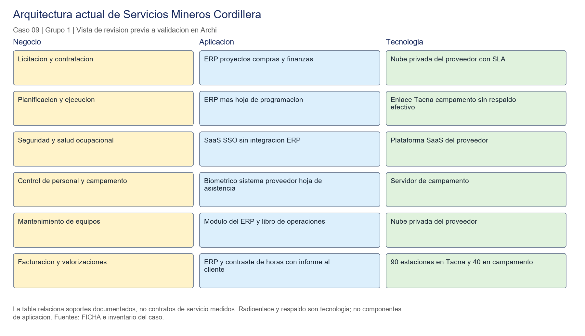
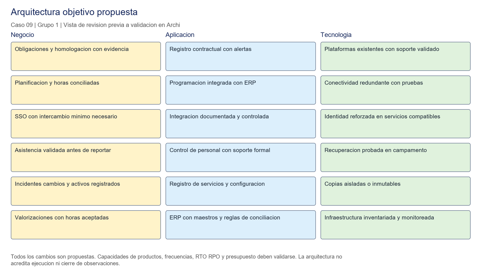
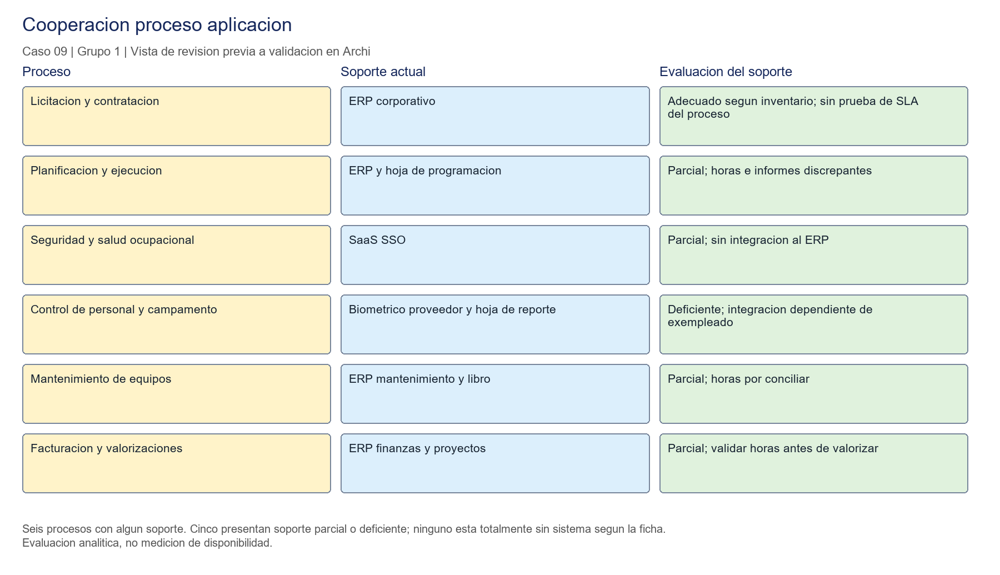

# Modelado de la arquitectura actual y objetivo en Archi

**UNIVERSIDAD PRIVADA DE TACNA**  
**FACULTAD DE INGENIER�A**  
**ESCUELA PROFESIONAL DE INGENIER�A DE SISTEMAS**

**Taller de laboratorio de la semana 10**  
**Caso 09 Servicios Mineros Cordillera S.A.C.**  
**Grupo 1**

**Curso:** Planeamiento Estrat�gico de TI  
**Docente:** Dr. Oscar Juan Jimenez Flores

**Integrantes**

| Apellidos y nombres | C�digo |
|---|---|
| Carbajal Vargas, Andre Alejandro | Reservado para la car�tula de entrega |
| Yupa G�mez, F�tima Sof�a | Reservado para la car�tula de entrega |
| Llanos Ni�o, Vincenzo Rafael | Reservado para la car�tula de entrega |

Tacna, Per� - 2026

**Alcance p�blico:** caso ficticio publicado por el docente, sin informaci�n operativa privada. V�ase [PROCEDENCIA.md](PROCEDENCIA.md).

## �ndice

1. Informaci�n sobre el evento pr�ctico
2. Procedimiento o metodolog�a
3. Resultados
4. Conclusiones
5. Cuestionario
6. Referencias bibliogr�ficas
7. Anexos

## 1. Informaci�n sobre el evento pr�ctico

### 1.1 T�tulo del evento pr�ctico

Modelado de la arquitectura actual y objetivo de Servicios Mineros Cordillera S.A.C. y an�lisis de brechas para su PETI.

El an�lisis prioriza la continuidad del enlace del campamento, el control de contratos y la evidencia de homologaci�n. Estos aspectos responden al objetivo de TI declarado en la ficha del caso. La interrupci�n de 14 horas demuestra que disponer nominalmente de un respaldo no garantiza que est� operativo cuando el negocio lo necesita.

### 1.2 Objetivos

- Establecer principios que orienten las decisiones de continuidad, datos, integraci�n y control de servicios del caso 09.
- Representar los procesos, aplicaciones, datos y tecnolog�a existentes con trazabilidad a la ficha y al inventario.
- Evaluar el soporte de los seis procesos e identificar diferencias entre sistemas y reportes.
- Proponer cambios de arquitectura vinculados con la homologaci�n y la continuidad, explicitando las validaciones necesarias.
- Derivar brechas, paquetes de trabajo y dependencias mediante un programa reproducible.

### 1.3 Tiempo de duraci�n

Una sesi�n de laboratorio y trabajo de consolidaci�n del equipo. La gu�a consultada no establece una cantidad de minutos; la duraci�n efectiva se registra al cerrar la sesi�n, sin presentar una estimaci�n como tiempo ejecutado.

### 1.4 Resultados de aprendizaje

Al finalizar, el equipo debe poder distinguir componentes de aplicaci�n de infraestructura, justificar una arquitectura objetivo a partir de hechos del negocio y demostrar c�mo una dependencia condiciona la secuencia de implementaci�n. Tambi�n debe reconocer los l�mites de los conteos y la diferencia entre una comprobaci�n estructural y una validaci�n del modelo en Archi.

### 1.5 Recursos

| Recurso | Versi�n o referencia | Uso y estado |
|---|---|---|
| Ficha del caso 09 | Material del curso; datos de 2025 | Hechos de gobierno, procesos, incidente y datos entregados |
| Inventario de arquitectura actual | 25 de junio de 2026 | Sistemas, integraciones, entidades, nodos y redes |
| Archi y ArchiMate | Lenguaje solicitado: ArchiMate 3.2; versi�n instalada de Archi por registrar | Modelo nativo preparado; apertura y exportaci�n desde Archi pendientes |
| Python | Ejecuci�n comprobada con 3.13.15 | Generaci�n de CSV, agrupaci�n y orden topol�gico |
| pandas | 2.3.3 | Matrices de brechas y paquetes |
| CSV | UTF-8 | Tablas versionables de entidades y soporte de procesos |
| Git y GitHub | Repositorio p�blico del Grupo 1 | Artefactos publicados mediante rama y PR; etiquetas pendientes |
| Plantilla grupal | SI886-S10-TALLER-Grupo_N1.docx | Estructura de siete secciones y datos de car�tula |

Los gr�ficos complementarios son previsualizaciones derivadas del mismo cat�logo del modelo. No se presentan como capturas ni exportaciones de Archi. No se necesit� draw.io para estos avances.

### 1.6 Seguridad

La gu�a clasifica el modelo completo como restringido y solicita un repositorio privado. Este repositorio p�blico contiene una representaci�n agregada del caso acad�mico; su publicaci�n no acredita el requisito de repositorio privado de la gu�a. Las vistas omiten direcciones IP, credenciales, rutas internas y versiones vulnerables. La matriz utiliza conteos agregados, sin nombres de trabajadores, documentos de identidad ni registros biom�tricos. Los conteos publicados por el caso se usan como insumo acad�mico; no se afirma haber auditado los archivos de transacciones.

## 2. Procedimiento o metodolog�a

### Paso A Declarar los principios de arquitectura

Se contrastaron la ficha y el inventario para identificar reglas que eviten repetir los problemas descritos. Se redactaron siete principios en `05_arquitectura/AR01_principios.md`; cada uno incluye nombre, declaraci�n, raz�n, implicancias y trazabilidad.

| C�digo | Principio | Decisi�n que orienta |
|---|---|---|
| PA01 | Continuidad demostrable | Contratar, mantener y probar la alternativa de conectividad y la recuperaci�n |
| PA02 | Dato �nico con responsabilidad | Formalizar fuentes, due�os y conciliaciones antes de integrar |
| PA03 | Integraciones mantenibles | Documentar, asignar soporte y probar la reversi�n |
| PA04 | Identidad individual | Atribuir acciones y reducir privilegios compartidos |
| PA05 | Evidencia desde el dise�o | Registrar controles, obligaciones, cambios y aceptaci�n |
| PA06 | Protecci�n seg�n clasificaci�n | Limitar acceso y circulaci�n de informaci�n personal |
| PA07 | Reutilizaci�n con soporte | Evaluar capacidades del ERP y SaaS antes de duplicarlas |

La relaci�n entre PA01 y el incidente es directa: el sat�lite exist�a como alternativa, pero su contrato hab�a vencido nueve meses antes. La recuperaci�n requiere tanto condiciones t�cnicas como gesti�n contractual.

### Paso B Representar la arquitectura actual

Se elabor� el cat�logo de conceptos del archivo [AR05_catalogo.csv](https://github.com/Sofxx7/SI886-PETI-SEMANA10-Ficha9/blob/develop/05_arquitectura/AR05_catalogo.csv) y se gener� [AR05_Cordillera.archimate](https://github.com/Sofxx7/SI886-PETI-SEMANA10-Ficha9/blob/develop/05_arquitectura/AR05_Cordillera.archimate), que contiene los dos estados y cuatro vistas. El inventario funciona como base, pero los elementos se ubican seg�n su naturaleza: el enlace de datos es tecnolog�a; el ERP, el SaaS SSO, el control de personal y las tres hojas de c�lculo son aplicaciones o capacidades de aplicaci�n.

**Negocio.** Se representan licitaci�n y contrataci�n, planificaci�n y ejecuci�n, seguridad y salud ocupacional, control de personal y campamento, mantenimiento y facturaci�n. Se incorporan procesos auxiliares de contratos, administraci�n de TI, soporte, cambios y homologaci�n, sustentados en los hechos de la ficha.

**Aplicaci�n.** El ERP corporativo corre en nube privada y dispone de soporte con SLA. SSO es SaaS; control de personal se apoya en biometr�a y en un sistema de proveedor. Mantenimiento es un m�dulo del ERP. Se incluyen las hojas de programaci�n de servicios, vencimientos contractuales y reportes de asistencia, porque sostienen tareas operativas y no pueden omitirse del modelo.

**Tecnolog�a.** Se representan la nube privada del ERP, el SaaS, el servidor del campamento, las estaciones de Tacna y campamento, la conectividad entre sedes, el respaldo satelital inoperativo y el disco externo conectado al servidor. La ubicaci�n se representa sin detalles internos sensibles.

**Cooperaci�n proceso aplicaci�n.** La evaluaci�n de soporte se registra en [AR04_proceso_aplicacion.csv](https://github.com/Sofxx7/SI886-PETI-SEMANA10-Ficha9/blob/develop/05_arquitectura/AR04_proceso_aplicacion.csv).

| Proceso | Soporte actual | Evaluaci�n y evidencia |
|---|---|---|
| Licitaci�n y contrataci�n | ERP | Adecuado seg�n inventario; no se acredita una deficiencia directa de este proceso |
| Planificaci�n y ejecuci�n | ERP y hoja de programaci�n | Parcial: horas facturables distintas entre informe y ERP |
| Seguridad y salud ocupacional | SaaS SSO | Parcial: sin integraci�n al ERP; revisar cobertura de personal |
| Control de personal y campamento | Biom�trico, sistema proveedor y hoja de reporte | Deficiente: dependencia del exempleado, archivo mensual y reporte discrepante |
| Mantenimiento | M�dulo ERP y libro de operaciones | Parcial: horas distintas entre ambas fuentes |
| Facturaci�n y valorizaciones | ERP | Parcial: requiere validar las horas que originan las valorizaciones |

Los seis procesos tienen alg�n soporte. Cinco de seis presentan soporte parcial o deficiente y uno de seis, control de personal, se clasifica como deficiente. No se identifican procesos totalmente sin sistema en la lista del caso. La clasificaci�n es un juicio del an�lisis, no una medici�n de disponibilidad ni una afirmaci�n de que todas las facturas est�n erradas.

**Estructura de la informaci�n.** Se registraron seis entidades en [AR02_entidades.csv](https://github.com/Sofxx7/SI886-PETI-SEMANA10-Ficha9/blob/develop/05_arquitectura/AR02_entidades.csv). Las cuatro primeras proceden del inventario; Proveedor y Pago se incorporan desde los conjuntos de datos descritos en la ficha.

| Entidad | Ubicaciones y conteos acreditados | Fuente y due�o actuales | Observaci�n |
|---|---|---|---|
| Personal | ERP 420; biom�trico hasta 700; SSO 480; planilla 420 | Sin fuente; Operaciones de hecho | Picos y plantillas no son poblaciones equivalentes |
| Equipo | ERP 310; libro 310; cliente 290 | ERP; Superintendente de Mantenimiento | Diferencia de conteos 20 y horas por conciliar |
| Contrato | ERP 140; hoja 140; papel 140 | Sin fuente ni due�o | Conteos iguales no garantizan vigencia |
| Servicio | ERP, libro e informe; 36 al a�o, sin desglose por sistema | ERP; Gerente de Operaciones | Horas facturables diferentes |
| Proveedor | `proveedores.csv`: 210 en 2025 | Sistema de origen, fuente y due�o no documentados | Contiene contacto y documento de identidad |
| Pago | `pagos.csv`: 25 185 en 2025 | Sistema de origen, fuente y due�o no documentados | Transacciones con registrador y aprobador |

Hay **2 de 6 entidades expresamente sin fuente autoritativa** y **2 de 6 sin informaci�n suficiente sobre su fuente**. En total, no se acredita fuente declarada para 4 de 6. En propiedad del dato, Contrato carece expresamente de due�o, Personal tiene responsable de hecho y Proveedor/Pago no tienen due�o documentado; solo Equipo y Servicio tienen cargo responsable identificado expl�citamente.

Se marcan tres entidades con datos personales: Personal, Proveedor y Pago. Personal se clasifica como restringida seg�n el inventario; la clasificaci�n confidencial de Proveedor y Pago es una propuesta pendiente de aprobaci�n. La ficha registra 421 personas en A y 420 registros de empleados en I: se requiere conciliar fecha y alcance, sin corregir arbitrariamente uno de los valores.



### Paso C Construir la arquitectura objetivo

Se tom� como base acreditada el objetivo de TI de la ficha: cerrar observaciones de homologaci�n y asegurar la continuidad del enlace. Se formularon capacidades propuestas en [AR06_derivacion_objetivo.md](https://github.com/Sofxx7/SI886-PETI-SEMANA10-Ficha9/blob/develop/05_arquitectura/AR06_derivacion_objetivo.md) para contratos y evidencia, conectividad, conciliaci�n, mantenimiento de integraciones, identidad y gesti�n de servicios.

La arquitectura objetivo conserva las capacidades soportadas del ERP y del SaaS y propone integraciones documentadas, maestros con responsabilidad, programaci�n conciliada, control contractual con alertas, conectividad redundante, copias aisladas o inmutables y registros de gesti�n. La ampliaci�n de m�dulos depende de validar licencias, funciones, soporte y costo total con proveedores.

Las secciones grupales de visi�n, capacidades, FODA y marcos no se adjuntaron al documento recibido. Por tanto, la propuesta tiene trazabilidad al caso y a los principios, y queda pendiente enlazarla con las secciones 2.2, 3.1.5, 3.5, 4.1.5 y 4.2 del PETI del grupo. No se utilizan las declaraciones de Bitel ni las estrategias del caso cl�nico.



### Paso D Analizar brechas y derivar paquetes

Se adapt� el programa de la gu�a a los hechos de Servicios Mineros Cordillera. Se a�adieron identificadores �nicos, relaciones a ambos estados del modelo y comprobaciones de integridad. La secuencia se calcula mediante orden topol�gico, por lo que un ciclo o una dependencia desconocida genera un error en lugar de imprimir una secuencia fija.

Desde `05_arquitectura/` se ejecut�:

```text
python AR03_brechas.py
python AR05_modelo.py
```

Se obtuvieron **17 brechas**: seis de negocio, cinco de aplicaci�n, tres de datos y tres de tecnolog�a. El esfuerzo se estim� ordinalmente como bajo, medio o alto: tres brechas bajas, doce medias y dos altas. No son d�as, soles ni una cotizaci�n.

| Paquete | Brechas | Esfuerzo m�ximo | Dependencias |
|---|---|---|---|
| PT01 Gobierno contractual y evidencia | BR01, BR15, BR16 | Medio | Ninguna |
| PT02 Gobierno y conciliaci�n del dato | BR06, BR07, BR17 | Medio | PT01 |
| PT03 Continuidad de enlace y respaldos | BR02, BR11 | Alto | PT01 |
| PT04 Integraci�n y programaci�n operativa | BR03, BR04, BR05, BR08 | Alto | PT02, PT03, PT05, PT06 |
| PT05 Identidad y control de acceso | BR09, BR10 | Medio | PT01 |
| PT06 Gesti�n de servicios, cambios y activos | BR12, BR13, BR14 | Medio | PT01 |

La secuencia propuesta es PT01 en el primer nivel; PT02, PT03, PT05 y PT06 en el segundo; PT04 en el tercero. La posici�n en el mismo nivel permite trabajo paralelo solo si existen personas y recursos. No se retrasa la recuperaci�n del respaldo hasta completar la integraci�n; PT03 debe resolver esa exposici�n antes de depender de intercambios m�s frecuentes.

### Paso E Preparar vistas y secci�n 5 del PETI

Se prepararon tres previsualizaciones en [graficos/](https://github.com/Sofxx7/SI886-PETI-SEMANA10-Ficha9/tree/develop/graficos) y cuatro vistas dentro del modelo: arquitectura actual, arquitectura objetivo, cooperaci�n proceso aplicaci�n e informaci�n actual y objetivo. La secci�n [05_arquitectura_empresarial.md](https://github.com/Sofxx7/SI886-PETI-SEMANA10-Ficha9/blob/develop/05_arquitectura/05_arquitectura_empresarial.md) re�ne principios, estado actual, propuesta y brechas para incorporarla al PETI.



Las PNG incluidas sirven para revisar el contenido y no se cuentan como exportaciones de Archi. La evidencia final deber� sustituirse por vistas exportadas despu�s de abrir y validar el modelo.

### Paso F Validar y corregir

Se ejecutaron las comprobaciones autom�ticas de referencias, unicidad de identificadores y correspondencia de las 17 brechas con conceptos de ambos estados. Tambi�n se comprob� que no hay ciclos entre los paquetes y que cada brecha pertenece a un paquete. Las salidas quedan en `evidencias/S10/salidas/`.

La revisi�n documental separ� el enlace de datos de los componentes de aplicaci�n, evit� equiparar picos de personal con la planilla y mantuvo como desconocidos los sistemas de origen de Proveedor y Pago. La apertura en Archi, la comprobaci�n sem�ntica de relaciones y la revisi�n de sus vistas siguen pendientes; validar XML no demuestra que la representaci�n sea aceptada por Archi ni que todas las relaciones sean adecuadas.

### Paso G Registrar evidencias y cerrar

Los artefactos se publican en el repositorio del Grupo 1 mediante la rama `taller-10-caso09` y un PR hacia `develop`. Las etiquetas `v0.10` y `taller-10` quedan pendientes del cierre del taller. Este repositorio corresponde exclusivamente al caso 09 y conserva las validaciones pendientes.

Los resultados de la secci�n 3 enlazan los artefactos publicados. El repositorio y el PR permiten contrastar el contenido y la fecha; las validaciones en Archi y la exportaci�n del informe siguen siendo necesarias antes de entregar.

## 3. Resultados

La tabla distingue los artefactos publicados de las validaciones pendientes. Un archivo enlazado no acredita por s� solo la apertura del modelo en Archi ni la ejecuci�n de los cambios propuestos en la organizaci�n.

| N.� | Resultado esperado | Estado comprobado | Evidencia preparada y pendiente |
|---:|---|---|---|
| 1 | Seis principios completos | Siete redactados | [AR01_principios.md](https://github.com/Sofxx7/SI886-PETI-SEMANA10-Ficha9/blob/develop/05_arquitectura/AR01_principios.md) |
| 2 | Modelo actual en tres capas | Archivo generado; apertura en Archi pendiente | [AR05_Cordillera.archimate](https://github.com/Sofxx7/SI886-PETI-SEMANA10-Ficha9/blob/develop/05_arquitectura/AR05_Cordillera.archimate) |
| 3 | Hojas como aplicaciones | Tres hojas incluidas en cat�logo actual | [AR05_catalogo.csv](https://github.com/Sofxx7/SI886-PETI-SEMANA10-Ficha9/blob/develop/05_arquitectura/AR05_catalogo.csv); validar en Archi |
| 4 | Cooperaci�n proceso aplicaci�n | Matriz de seis procesos y vista preparada | [AR04_proceso_aplicacion.csv](https://github.com/Sofxx7/SI886-PETI-SEMANA10-Ficha9/blob/develop/05_arquitectura/AR04_proceso_aplicacion.csv); exportaci�n desde Archi pendiente |
| 5 | Seis entidades y conteos | Seis registradas; dos sin sistema origen documentado | [AR02_entidades.csv](https://github.com/Sofxx7/SI886-PETI-SEMANA10-Ficha9/blob/develop/05_arquitectura/AR02_entidades.csv); validar faltantes |
| 6 | Fuentes y due�os ausentes contados | Ausencia confirmada diferenciada de informaci�n desconocida | [AR02_entidades.csv](https://github.com/Sofxx7/SI886-PETI-SEMANA10-Ficha9/blob/develop/05_arquitectura/AR02_entidades.csv) |
| 7 | Datos personales y clasificaci�n | Tres entidades marcadas; dos clasificaciones propuestas | [AR02_entidades.csv](https://github.com/Sofxx7/SI886-PETI-SEMANA10-Ficha9/blob/develop/05_arquitectura/AR02_entidades.csv); aprobaci�n de clasificaci�n pendiente |
| 8 | Objetivo trazado a su origen | Propuesta enlazada al caso y principios | [AR06_derivacion_objetivo.md](https://github.com/Sofxx7/SI886-PETI-SEMANA10-Ficha9/blob/develop/05_arquitectura/AR06_derivacion_objetivo.md); falta contrastar el PETI grupal |
| 9 | Diez brechas con esfuerzo y dependencias | Diecisiete calculadas | [AR03_brechas.csv](https://github.com/Sofxx7/SI886-PETI-SEMANA10-Ficha9/blob/develop/05_arquitectura/AR03_brechas.csv); validaci�n en Archi pendiente |
| 10 | Paquetes derivados | Seis calculados | [AR03_paquetes.csv](https://github.com/Sofxx7/SI886-PETI-SEMANA10-Ficha9/blob/develop/05_arquitectura/AR03_paquetes.csv) y [AR03_salida.txt](https://github.com/Sofxx7/SI886-PETI-SEMANA10-Ficha9/blob/develop/evidencias/S10/salidas/AR03_salida.txt) |
| 11 | Secuencia por dependencias | Tres niveles; sin ciclos | [AR03_secuencia.json](https://github.com/Sofxx7/SI886-PETI-SEMANA10-Ficha9/blob/develop/05_arquitectura/AR03_secuencia.json) y salida |
| 12 | Tres vistas exportadas desde Archi | Pendiente; existen tres previsualizaciones | [graficos/](https://github.com/Sofxx7/SI886-PETI-SEMANA10-Ficha9/tree/develop/graficos); sustituir por exportaciones de Archi |
| 13 | Secci�n 5 y versi�n v0.10 | Secci�n redactada; etiqueta y consolidaci�n pendientes | [05_arquitectura_empresarial.md](https://github.com/Sofxx7/SI886-PETI-SEMANA10-Ficha9/blob/develop/05_arquitectura/05_arquitectura_empresarial.md); PR y etiquetas pendientes |

### Problemas y mejoras

Faltan la visi�n y las dem�s secciones previas del PETI grupal y el detalle de las nueve observaciones. Debe resolverse la diferencia entre la publicaci�n p�blica y el requisito de repositorio privado de la gu�a. No se han revisado los siete datasets completos; sus conteos se citan desde la ficha. Es necesario validar los sistemas de origen, fuentes y due�os de Proveedor/Pago; las fechas de Personal y el alcance del registro de equipos del cliente; y los RTO/RPO del BIA. Estos faltantes impiden afirmar cumplimiento integral y deben mantenerse visibles hasta resolverlos.

## 4. Conclusiones

1. El incidente muestra que la continuidad depende de la gesti�n de obligaciones adem�s de la infraestructura: el respaldo satelital qued� inoperativo por vencimiento contractual. Por ello BR01 y BR02 deben coordinarse; comprar o conservar un enlace alterno sin vigilar su contrato mantiene la exposici�n.
2. Igualar conteos no garantiza calidad. Los 140 contratos coinciden en tres ubicaciones y aun as� el vencimiento pas� inadvertido; los conteos de Personal corresponden a coberturas distintas. La conciliaci�n debe validar significado, vigencia y responsable, adem�s de cantidad.
3. Los seis procesos tienen soporte, pero cinco presentan limitaciones documentadas o derivadas de los flujos descritos. El problema principal exige mejorar integraci�n, responsabilidad y continuidad antes de proponer reemplazos indiscriminados del ERP que ya tiene soporte.
4. Los seis paquetes y sus dependencias muestran que la integraci�n necesita datos, acceso, continuidad y cambios controlados. La secuencia calculada evita tratar esas condiciones como iniciativas aisladas, aunque todav�a requiere validaci�n del equipo y del negocio.

## 5. Cuestionario

La gu�a no presenta un cuestionario numerado. En el Paso G solicita responder en dos frases la pregunta de transferencia:

**�Qu� riesgo correr�a una organizaci�n real si esto se hiciera mal?**

Una arquitectura que omita contratos vencidos, hojas operativas o discrepancias de datos puede justificar inversiones que no resuelven la interrupci�n del campamento ni la informaci�n con la que se reporta y factura. Una secuencia que adelante integraciones sin continuidad, control de acceso y conciliaci�n puede ampliar la exposici�n de datos y reproducir errores en m�s sistemas, manteniendo penalidades y observaciones de homologaci�n.

## 6. Referencias bibliogr�ficas

- Jimenez Flores, O. J. (2026). *Semana 10 Modelado de la arquitectura actual y objetivo en Archi* [Gu�a de taller, SI-886]. Universidad Privada de Tacna. https://github.com/OscarJimenezFlores/PETI/blob/main/SEMANA-10/3-TALLER.md
- Jimenez Flores, O. J. (2026). *Servicios Mineros Cordillera S.A.C. Ficha de la organizaci�n* [Caso acad�mico 09]. Universidad Privada de Tacna. https://github.com/OscarJimenezFlores/PETI/blob/main/SEMANA-10/RECURSOS-TALLER/EMPRESA-09-servicios-mineros-cordillera/FICHA.md
- Jimenez Flores, O. J. (2026, 25 de junio). *Inventario de la arquitectura actual de Servicios Mineros Cordillera S.A.C.* [Caso acad�mico 09]. Universidad Privada de Tacna. https://github.com/OscarJimenezFlores/PETI/blob/main/SEMANA-10/RECURSOS-TALLER/EMPRESA-09-servicios-mineros-cordillera/arquitectura-actual.md
- The Open Group. (2022). *ArchiMate 3.2 Specification* (C226). https://pubs.opengroup.org/architecture/archimate3-doc/
- The Open Group. (2022). *The TOGAF Standard, 10th Edition*. https://www.opengroup.org/togaf
- ISACA. (2018). *COBIT 2019 Framework Governance and Management Objectives*. Objetivo APO03 Managed Enterprise Architecture. https://www.isaca.org/resources/cobit
- Archi. (s. f.). *Archi Open Source ArchiMate Modelling*. https://www.archimatetool.com/

Los hechos y conteos del caso se sustentan en los tres primeros materiales. Los marcos restantes son referencias metodol�gicas de la gu�a; no acreditan certificaci�n ni cumplimiento de controles en la empresa.

## 7. Anexos

| Anexo | Contenido | Referencia en el informe |
|---|---|---|
| A | Modelo [AR05_Cordillera.archimate](https://github.com/Sofxx7/SI886-PETI-SEMANA10-Ficha9/blob/develop/05_arquitectura/AR05_Cordillera.archimate) y cat�logo | Pasos B, C y F |
| B | Matriz de cooperaci�n y PNG de revisi�n | Pasos B y E |
| C | [AR02_entidades.csv](https://github.com/Sofxx7/SI886-PETI-SEMANA10-Ficha9/blob/develop/05_arquitectura/AR02_entidades.csv) | Paso B y resultados 5 a 7 |
| D | [AR01_principios.md](https://github.com/Sofxx7/SI886-PETI-SEMANA10-Ficha9/blob/develop/05_arquitectura/AR01_principios.md) y derivaci�n objetivo | Pasos A y C |
| E | Programa, CSV, paquetes, secuencia y salida de brechas | Paso D |
| F | Secci�n 5 del PETI | Paso E |
| G | Validaci�n estructural del modelo | Paso F |
| H | Ficha e inventario del caso 09 | Informaci�n y diagn�stico |

Las capturas exportadas de Archi y las etiquetas se incorporar�n despu�s de ejecutar y comprobar esas acciones. El repositorio del Grupo 1 contiene los dem�s artefactos preparados.


**Repositorio del Grupo 1:** https://github.com/Sofxx7/SI886-PETI-SEMANA10-Ficha9
